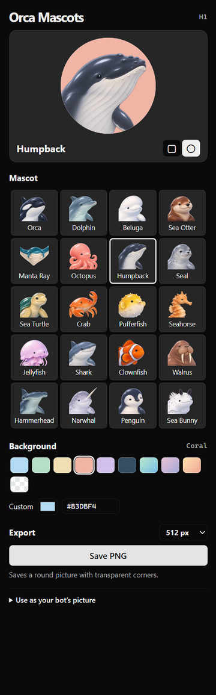

# Orca Mascots

Design a marine avatar in the Orca Desktop sidebar. Choose from 20 illustrated animals, customise the background, and save a square PNG. Orca Mascots is an unofficial community plugin, unaffiliated with the Orca authors.



## Install from GitHub

Requires Orca Desktop 1.4.265 or later with isolated plugin frames. Turn on plugins in **Settings → Plugins**, then run:

```sh
orca plugin install manomilano/orca-mascots --json
```

Orca shows the repository, publisher, and requested access before installing. Expect one sandboxed sidebar panel with an empty capability list. Review the details and run the command Orca returns with its exact `--approve` fingerprint. Open **Orca Mascots** in the right sidebar.

## Design and export

1. Select an animal in the gallery. Keyboard users can Tab through the buttons and press Enter or Space to select.
2. Choose a solid, gradient or transparent swatch. For a custom solid, use the colour picker or enter a three- or six-digit hex value. Sky blue (`#B3DBF4`) matches the default background of the built-in mascots.
3. Choose the picture shape. Square saves the entire image (Orca rounds the corners itself when it shows a bot). Circle saves exactly the round picture in the preview, with transparent corners. The checkerboard shows transparency.
4. Choose **512 px** or **1024 px**, then **Save PNG** and choose a destination in Orca’s save dialog.

The panel remembers your animal, background, last custom colour, preview shape and export size in its local plugin storage. All artwork is bundled and the panel runs offline.

### Use as your bot’s picture

Save the 512 px PNG, open the bot’s settings and upload it in the picture picker. Orca’s plugin API cannot apply bot avatars or register native mascot IDs. Direct application would require an upstream host method to select a bot and submit an approved picture upload. Saving and bundled asset loading require Orca Desktop’s isolated frame.

## Development

Python 3 and Pillow build WebP foregrounds and the listing icon from the tracked 1024 × 1024 transparent PNG masters. Edit the animal labels in `scripts/build_assets.py` and rerun it to rebuild the catalog. The script reports missing masters. The background presets and preferences live in `panel/compose.mjs`.

```sh
python -m pip install Pillow
python scripts/build_assets.py
orca plugin validate . --json
orca plugin inspect . --json
orca plugin test . --json
orca plugin check . --json
orca plugin dev watch . --check --shot ./.orca/shots --json
```

Run release inspection in a clean checkout. Orca includes local files in its size calculation, so ignored image-generation scratch files in a working checkout can exceed the 50 MiB inspection limit. The GitHub release includes the tracked masters and build script alongside the runtime assets.

Review the dev-load access request as for installation. In a desktop workspace, use `orca plugin shot local.mascots --panel gallery --width 340 --out docs/gallery.png` for a fresh screenshot. Inspect the frame logs with `orca plugin logs local.mascots --json`. Stop the watch with Ctrl+C and unload a remaining dev registration with `orca plugin dev unload . --json`. The node tests exercise the shared catalog, preferences and SVG logic. Desktop QA should also exercise the save dialog and the bot’s PNG upload.

## Licences

The plugin code, build script, tests, configuration and documentation text use the [MIT License](LICENSE). The mascot master images, distributed foregrounds, icon and illustrations in exports use [CC BY 4.0](LICENSE-ARTWORK.md).
